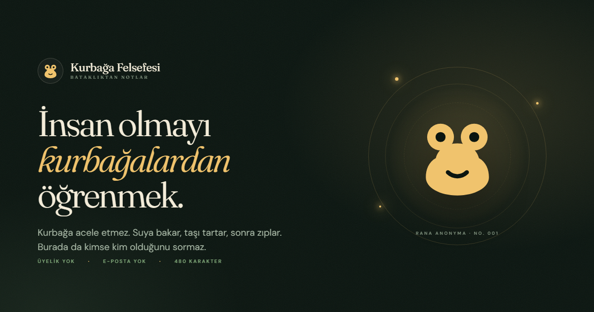

# NO.46 — Dijital Karargâh

Giriş kapılı, siyah temalı, davet kodlu NO.46 sitesi. Node.js + Node 22’nin
yerleşik SQLite’ı (`node:sqlite`) + bcryptjs kullanır. Ekstra derleme adımı yoktur.

## Çalıştırma

```powershell
npm install
Copy-Item .env.example .env   # ilk kez
npm start
```

> **Node.js gerekli.** `node --version` komutu hata verirse Node.js kurulu
> değildir; `winget install OpenJS.NodeJS.LTS` ile kurabilirsin. Proje kökündeki
> `.nvmrc` önerilen sürümü (26) belirtir; `nvm use` ile o sürüme geçebilirsin.

### Duman testi (site açılıyor mu?)

Değişikliklerden sonra giriş sonrası ana sayfanın açıldığını ve yönlendirme
döngüsü oluşmadığını doğrulamak için:

```powershell
npm test
```

Test geçici bir veritabanıyla sunucuyu ayağa kaldırır, kayıt/giriş yapar ve
`/` sayfasının 200 döndüğünü kontrol eder; takılırsa hata koduyla çıkar.

Ardından `http://127.0.0.1:4173/` adresini aç. Kayıt için `.env` içindeki
`INVITE_CODES` alanını kullan. Varsayılan yerel kod: `NO46-2026`.

> **Kurbağa felsefesi sayfası korunmuştur.** `kurbağa.html` ve eski
> `assets/js/app.js`, `store.js`, `config.js`, `auth.js`, `base.css`, `wall.css`
> dosyalarına dokunulmadı. Sunucu, oturum olmadan bu sayfayı göstermez.

## 3D Lab

- **https://127.0.0.1:4173/lab** → Prompt’taki 21st.dev bileşeninin birebir iframe sürümü.
- **https://127.0.0.1:4173/lab/local** → Yerel React + Three + Tailwind build sürümü.

Yerel sürümün kaynağı `lab/` klasöründedir. Build almak için:

```powershell
cd lab
npm install
npm run build
```

Build çıktısı `lab/dist` içine alınır; ana sunucu `/lab/local` adresini oradan servis eder.

## Yeni kültürel yazı ekleme (5 satır)

1. `data/articles.json` dosyasını aç.
2. İlgili kategori dizisine yeni bir nesne ekle.
3. `id`, `category`, `title`, `summary`, `body`, `source`, `sourceUrl` alanlarını doldur.
4. `body` 120–250 kelime olsun; metni kendi cümlelerinle yaz.
5. Sunucuyu yeniden başlat; yazı menüde otomatik görünür.



## Neler var?

- Ana sayfa menüsü: üst menüdeki **Kurbağa Felsefesi** alanına tıklayınca one-page açılır.
- Siyah giriş ekranı; kullanıcı adı + şifre ile giriş.
- **Kayıt ol** düğmesi kayıt formu açmaz; TikTok yayınlarında aktif olma ve seçilme bilgisini gösterir.
- Yönetim paneli: kullanıcı ekleme/çıkarma, karakter fotoğrafı ve rozet atama.
- 12 koltuklu rütbe sistemi: 3 gün giriş yapmayan koltuğu düşer, sıradaki uygun puanlı kişi geçer.
- Geri gelen eski koltuk sahibi için mevcut kullanıcılara “verelim / vermeyelim” oylaması açılır.
- Oylamada koltuk verilmezse kullanıcının profilinde komik bir görev görünür.
- Notlar tarayıcıda güvenli biçimde (`textContent`) gösterilir; HTML enjekte edilmez.
- Karakter sayacı, taslak kaydetme, gönderim sonrası kısa bekleme süresi ve kopyalama.
- Mobil menü, klavye erişimi, azaltılmış hareket desteği ve erişilebilir diyalog.
- Varsayılan olarak **yerel demo**: notlar, kullanıcılar ve puanlar tarayıcının
  `localStorage` alanında saklanır. Ortak duvar ve gerçek üyelik için cPanel API'si
  kurulmalıdır.

## Hızlı başlangıç

`index.html` dosyasını doğrudan açmak çoğu tarayıcıda çalışır; ancak bulut
modunu ve bazı tarayıcı API'lerini doğru test etmek için yerel bir sunucu
kullanmak daha iyidir.

```powershell
# Python 3 kuruluysa
python -m http.server 8080

# Alternatif: Node.js ile
npx serve .
```

Ardından `http://localhost:8080` adresini aç. Ana sayfa `index.html`,
Kurbağa Felsefesi one-page'i `kurbağa.html`, yönetim paneli `admin.html`
adresindedir.

## GitHub Pages'e yükleme

1. GitHub'da bir repository oluştur.
2. Bu klasördeki tüm dosyaları repository'nin köküne yükle. `assets/`,
   `favicon.svg`, `index.html`, `kurbağa.html` ve `admin.html` birlikte yüklenmeli.
3. **Settings → Pages → Build and deployment** bölümünde
   **Deploy from a branch** seçeneğini kullan.
4. Branch olarak `main`, klasör olarak `/ (root)` seç ve kaydet.
5. Sayfan birkaç dakika içinde `https://<kullanıcı>.github.io/<repo>/`
   adresinde yayına çıkar.

`.nojekyll` dosyası GitHub Pages'in dosyaları Jekyll ile işlemesini engeller;
bu repo için gereklidir ve silinmemelidir.

## Herkese açık ortak duvar (Supabase)

Varsayılan yerel demo modunda notlar başka ziyaretçiler tarafından görülmez.
Ortak bir duvar için ücretsiz bir Supabase projesi açıp iki anahtar girmen
yeterlidir.

1. [supabase.com](https://supabase.com) üzerinde yeni bir proje oluştur.
2. Projenin **SQL Editor** bölümünü aç.
3. `supabase/schema.sql` dosyasının içeriğini yapıştırıp çalıştır.
   Bu SQL:
   - `notes` tablosunu ve `created_at` indeksini oluşturur,
   - satır seviyesi güvenliğini (RLS) açar,
   - anonim kullanıcılara yalnızca **okuma** ve **not ekleme** izni verir,
   - güncelleme ve silme izni vermez.
4. **Settings → API** bölümünden **Project URL** ve **anon public** anahtarını
   kopyala. `service_role` anahtarını **asla** kullanma.
5. `assets/js/config.js` dosyasında bu iki alanı doldur:

   ```js
   window.KF_CONFIG = {
     cloud: {
       provider: "supabase",
       supabaseUrl: "https://xxxxx.supabase.co",
       supabaseAnonKey: "eyJhbGciOi...",
       table: "notes"
     },
     // ...
   };
   ```

6. Sayfayı yenile. Üstteki durum etiketi `yerel demo` yerine
   `herkese açık` olmalı ve notlar artık aynı veritabanında saklanır.

> Not: `config.js` herkese açık bir ön yüz yapılandırmasıdır; içine yalnızca
> `anon public` anahtarını yaz. Supabase'in `service_role` anahtarı arka uç
> içindir ve tarayıcıya konulmamalıdır.

### Veritabanını doğrulama

Supabase tablosunda hızlı bir kontrol:

```sql
select count(*) from public.notes;
```

Yeni bir not gönderdikten sonra bu sayının artması, bulut bağlantısının çalıştığını
gösterir. Notları silmek veya denetlemek istersen Supabase Dashboard →
**Table Editor → notes** bölümünü kullanabilirsin.

## GitHub Pages + cPanel sunucusu (önerilen)

Bu projede ön yüz GitHub Pages'te, dinamik kısım kendi sunucunda çalışacak şekilde
hazırlandı:

```text
https://routermurti.github.io/kurbaga/   → statik ön yüz
                    │
                    │ HTTPS + CORS
                    ▼
https://api.perihanmustafayeva.com/api.php → cPanel API
                    │
                    ▼
              MySQL: wwwafyon_kurbaga
```

- GitHub Pages'te yalnızca HTML/CSS/JS yayınlanır.
- Notlar, kullanıcı hesapları ve rate limit cPanel sunucusunda çalışır.
- `server/` klasörü cPanel'e yüklenir; GitHub Pages'e yüklenmez.
- Ayrıntılı cPanel, MySQL, SSL ve `config.js` adımları için
  [DEPLOY.md](DEPLOY.md) dosyasına bak.

Kısa özet:

1. cPanel'de `api` subdomain'i oluştur: `api.perihanmustafayeva.com`.
2. `server/` içindeki dosyaları `/public_html/api` klasörüne yükle.
3. MySQL veritabanı ve kullanıcı oluştur, `server/schema.sql` dosyasını içe aktar.
4. `server/config.php` içindeki DB bilgilerini ve `ip_salt` değerini doldur.
5. `assets/js/config.js` içinde `provider: "custom"` ve
   `apiBase: "https://api.perihanmustafayeva.com/api.php"` yap.
6. GitHub'a `config.js` değişikliğini yükle; Pages yeniden yayınlasın.

## Dosya yapısı

```text
.
├── index.html              # Ana sayfa ve giriş ekranı
├── kurbağa.html            # Kurbağa Felsefesi one-page
├── admin.html              # Yönetim paneli
├── assets/
│   ├── css/
│   │   ├── base.css        # Renkler, tipografi, header, hero, genel düzen
│   │   ├── wall.css        # Not duvarı, form, kartlar, bilgelik kartı
│   │   ├── auth.css        # Siyah giriş ekranı ve kullanıcı puanı
│   │   ├── home.css        # Ana sayfa menüsü
│   │   └── admin.css       # Yönetim paneli
│   ├── img/
│   │   ├── og.png          # Sosyal paylaşım önizlemesi (1200 × 630)
│   │   └── no46-garden-frogs.jpg # Giriş ekranı arka planı
│   └── js/
│       ├── app.js          # Arayüz etkileşimleri ve duvar mantığı
│       ├── auth.js         # Giriş, oturum ve puan
│       ├── admin.js        # Yönetim paneli
│       ├── ranks.js        # Rütbe ve koltuk sistemi
│       ├── config.js       # API/Supabase seçimi ve duvar limitleri
│       └── store.js        # localStorage / cPanel API / Supabase adaptörü
├── server/                 # cPanel'e yüklenecek PHP API (GitHub Pages'e yüklenmez)
│   ├── api.php             # Notlar + kullanıcı uç noktaları
│   ├── config.php          # MySQL ve CORS ayarları
│   ├── db.php              # PDO bağlantısı
│   ├── schema.sql          # MySQL tabloları
│   └── .htaccess
├── supabase/
│   └── schema.sql          # Supabase tablo, indeks ve RLS politikaları
├── DEPLOY.md               # GitHub Pages + cPanel kurulum rehberi
├── favicon.svg
├── .nojekyll
└── README.md
```

## Özelleştirme

- **Ana sayfa metinleri:** `index.html`.
- **Kurbağa one-page metinleri:** `kurbağa.html`.
- **Renkler ve tipografi:** `assets/css/base.css` içindeki `:root` değişkenleri.
- **Bilgelik kartları:** `assets/js/app.js` içindeki `QUOTES` dizisi.
- **Duvar limitleri:** `assets/js/config.js` içindeki `wall` bölümü.
  Varsayılanlar: 480 karakter not, 24 karakter takma ad, 60 not, 20 saniye
  gönderim aralığı, 60 saniyede bir yenileme.
- **Sosyal önizleme:** `assets/img/og.png` dosyasını değiştirip
  `index.html` içindeki `og:image` yolunu güncelle. Paylaşım önizlemesi göreli
  yolu çözmezse `og:image` ve `twitter:image` içeriklerini sitenin tam URL'si
  ile yaz.

## Giriş, kayıt ve puan

Ana sayfa açıldığında siyah bir giriş ekranı gelir. Kullanıcı adı ve şifre ile
giriş yapılır.

- **Kayıt ol** düğmesi kayıt formu açmaz. Kullanıcılara TikTok yayınlarında aktif
  olmaları ve seçilmeleri gerektiği bilgisi gösterilir.
- Kullanıcıları yönetici panelinden ekleyebilirsin.
- Şifreler düz metin olarak saklanmaz; PBKDF2-SHA256 ile hash'lenir.
- Oturum, kullanıcılar ve puanlar `localStorage` içinde tutulur.
- Sitede görünür sekmede **10 saniyede 1 puan** kazanılır.
- Puanlar üst menüdeki kullanıcı rozetinde görünür.
- Çıkış yapmak için üst menüdeki **Çıkış** düğmesini kullan.
- Rütbe/rütbeleme sistemi henüz yok; puan altyapısı hazır.

Bu kısım yerel demo içindir. cPanel API'sine geçildiğinde giriş, kullanıcı ve
puan kayıtları sunucuya taşınmalıdır.

## Yönetim paneli

Yönetim paneli `admin.html` adresindedir ve yalnızca yönetici içindir.

- İlk açılışta yönetici hesabı kurulumu yapılır.
- Kullanıcı ekleme ve silme.
- Kullanıcıya karakter fotoğrafı ekleme/değiştirme.
- Kullanıcıya yıldız, kurukafa, ilaç, mantar, viski, sigara rozetleri ekleme.
- Kullanıcıların puanlarını görme, puan ekleme ve sıfırlama.
- Rütbe koltuklarının puan eşiklerini düzenleme.
- Yeni rütbe koltuğu ekleme, açıklama yazma, sıralamayı değiştirme ve silme.
- Panel yerel demo olarak `localStorage` kullanır; üretimde sunucu tarafında
  korunmalıdır.

## Rütbe ve koltuk sistemi

`assets/js/ranks.js` 12 başlangıç rütbesi ve tek kişilik koltuk tanımlar.
Rütbeleri yönetim panelinden ekleyebilir, açıklamalarını ve puan eşiklerini
düzenleyebilir, sıralarını değiştirebilir ve silebilirsin. Değişiklikler
`localStorage` içinde `kf.rankdefs.v1` anahtarında tutulur.

- Kullanıcı giriş yaptığında son giriş zamanı kaydedilir.
- 3 gün (72 saat) giriş yapmayan koltuk düşer.
- Boşalan koltuğa, puanı yeten ve en yüksek puanlı uygun kullanıcı oturur.
- Eski koltuk sahibi geri geldiğinde koltuk boşsa mevcut kullanıcılara oylama açılır.
- Oylama sonucu koltuğu geri verirse eski sahibi geçer; vermezse profilinde komik bir görev belirir.
- Bir kullanıcı aynı anda yalnızca bir koltukta oturabilir.
- Koltuklar ana sayfada ve yönetim panelinde listelenir.

## Davranış ve sınırlar

- **Yerel demo:** Notlar, kullanıcılar ve puanlar yalnızca ziyaretçinin
  tarayıcısında tutulur; sayfa yenilendiğinde kaybolmaz, ancak başka cihazlardan
  görünmez.
- **Uzak mod:** Notlar ortak veritabanında saklanır; cPanel API veya Supabase
  kullanılabilir. Herkes okuyabilir ve not ekleyebilir. Kişisel bilgi paylaşımını
  engelleyen bir arayüz/uyarı bulunur; yine de kullanıcıların yazdıklarından
  kullanıcı sorumludur.
- **Moderatör yoktur.** Site, spam ve uygunsuz içerik için otomatik filtreleme
  yapmaz. Gerekirse cPanel/phpMyAdmin veya ek bir yönetim katmanıyla denetim
  ekleyebilirsin.
- **Sunucu erişilemezse** son görülen notlar gösterilir ve durum etiketi
  `bağlantı yok` olur. Yeni not gönderimi tekrar denemeye açıktır.
- **Tarayıcı desteği:** Güncel Chrome, Edge, Firefox ve Safari. `dialog`
  ve `IntersectionObserver` desteklenmeyen eski tarayıcılarda temel içerik
  yine okunabilir; animasyonlar ve bazı etkileşimler sadeleşir.

## Lisans

MIT Lisansı. Ayrıntılar için [LICENSE](LICENSE) dosyasına bak.